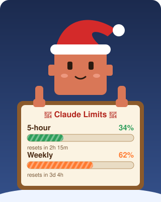

<div align="center">


# 🎅 Santa Limits

**A festive Claude Code mod: Claude in a Santa hat, holding a sign with your usage limits.**

See how much of your **5-hour** and **weekly** limits you have used, with snow falling while you work.


<br><br>



</div>

---

## ✨ Features

- **A band above the prompt.** A tiny Claude in a Santa hat with two progress bars (5-hour and weekly) on a snowy night sky. It is always visible.
- **A full panel.** A bigger Claude, gently bobbing and blinking, holds a wooden sign with your limits and when each one resets.
- **Color-coded bars:** 🟢 under 50%, 🟠 from 50% to 80%, 🔴 from 80%.
- **Live updates.** The figures refresh after every reply, and the reset countdown ticks every minute.
- **Works in the terminal too.** There it shows a compact text line.

## 📦 Install

At the prompt of a Claude Code terminal session:

```
/plugin install santa-limits --marketplace NODEPY/claude-santa-limits
```

Answer `y` to add the marketplace, then pick a scope (user scope makes it load in every session).

Or from your shell:

```bash
claude plugin marketplace add NODEPY/claude-santa-limits
```

```bash
claude plugin install santa-limits@santa-limits
```

Once it is installed at the user scope, it also shows up in the Claude desktop app's Code tab.

## 🎄 Usage

| What | How |
| --- | --- |
| See your limits at a glance | Look at the band above the prompt |
| Open the big Santa panel | Press **🎅 Panel** on the band, or run `/santa` |
| Reset times | Hover the band, or open the panel |

> [!NOTE]
> Limits are shown only on a Claude subscription (Pro / Max). The figures come from the last API response, so the sign shows "No limit data yet" until the first reply in a session. With an API key there are no limit windows to show.

## 🛠 How it works

Santa Limits is a Claude Code hooks mod (`hooks/register.tsx`):

- `session.measure` and `$.session.usage()` provide the `five_hour` and `seven_day` rate-limit windows.
- `ui.render` on `AbovePrompt` draws the band, and on `Pane` it draws the panel, as animated SVG on the desktop and as text in the terminal.
- `/santa` opens the panel.

## 📄 License

[MIT](LICENSE)
